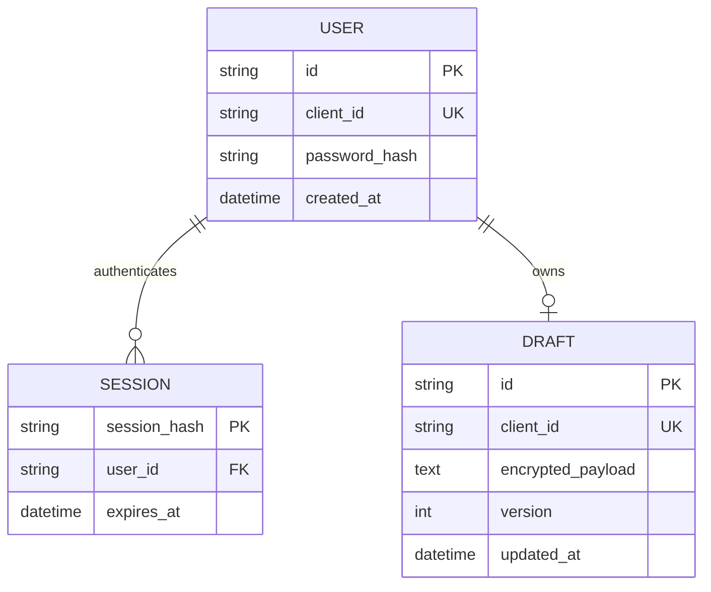

# ER-диаграмма

Доступ к `DRAFT` идёт только через активную `SESSION`, найденную по HttpOnly-cookie. В базе нет открытого пароля: `password_hash` содержит PBKDF2-SHA256 с солью. В `DRAFT` содержимое заявки хранится в зашифрованном blob, а проверка версии обеспечивает атомарность и не даёт старому устройству затереть более новую версию.
